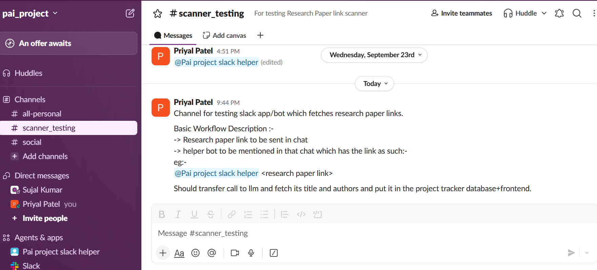

# 23rd September

- Created a Slack app to watch for research paper links shared in the project channel.
- Set it up so the app listens when someone mentions its bot.
- Created a testing channel and invited the app and bot.

# 5th October

- Connected Slack mentions to the database. The app saves each message, finds paper links in it, and records the papers and where they were shared.
- Added duplicate protection so Slack retrying the same message does not create extra records.
- Added two signed-in API routes to list saved papers and view one paper, with an optional status filter on the list.
- Added tests for repeated messages, messages with no links, messages with multiple links, and the papers API. The Slack API and paper repository are stubbed where useful in the tests.
- Updated the setup instructions and configuration notes for running Slack in Socket Mode.
- Fixed a flaky test found in review of PR #10. `IngestionReplayTest` saved papers and never rolled them back, so `SlackTablesTest.duplicatePaperUrlIsRejected` sometimes failed on a duplicate arXiv link when it ran second. The test is now `@Transactional` and the manual clean-up is removed.
- Checked the other database tests: they are `@Transactional` or use mocks, so nothing else leaked. Ran the suite in reverse order to confirm (45 tests pass).
- Added a line to `CLAUDE.md`: database tests must be `@Transactional` because all tests share one database.

# 6th October

- Started the paper resolvers (first step of filling in a paper's title, authors and date). `CrossrefResolver` handles DOI links and `ArxivResolver` handles arXiv links.
- Each returns the details or "not found". Network failures are passed up so the later worker can retry instead of marking the paper unresolved.
- Tests run against a fake server (WireMock) using responses recorded from the real Crossref and arXiv APIs, including a DOI that doesn't exist, an arXiv ID that doesn't exist and a badly formed arXiv ID.
- Not wired in yet: the worker that runs them on pending papers and stores the results is the next branch.

- Added the worker that fills in papers. Every 30 seconds it takes one waiting paper at a time, looks it up with the Crossref or arXiv resolver, and saves the title, authors, date and DOI. Papers the sources don't know become UNRESOLVED.
- If a source is down, the paper stays pending and is retried; after 3 failed tries it becomes UNRESOLVED. A paper that keeps failing goes to the back of the queue so it doesn't hold up newer ones.
- New migration `V4__add_paper_metadata.sql` adds the title, authors, date, DOI, source and attempts columns. The papers API now returns these too.
- The worker is switched off in tests so they never call the real websites (`PAPER_RESOLUTION_ENABLED=false` does the same locally).
- Checked once against the live services: an arXiv link and a Springer DOI were resolved, and a made-up DOI and a plain website link became UNRESOLVED.

# 7th October

- Added the second way of finding paper details: reading the citation tags that publishers put on their article pages (title, authors, date, DOI). It is tried only when Crossref and arXiv don't know the link.
- If the page names a DOI, Crossref is asked for it so the official record is used instead of the page's version. Authors written as "Last, First" are flipped to match the other sources.
- Each paper now records which route found it (registry or page tags). Bare PDF links, pages that refuse access and pages without citation tags are left for the next step.
- Tested with fixtures trimmed from the real Springer and Nature pages. Checked live: a Nature link, an arXiv-registered DOI and an arXiv link resolved. A bare PDF and an IEEE link stayed UNRESOLVED, because IEEE sends an empty reply to anything that isn't a browser.
